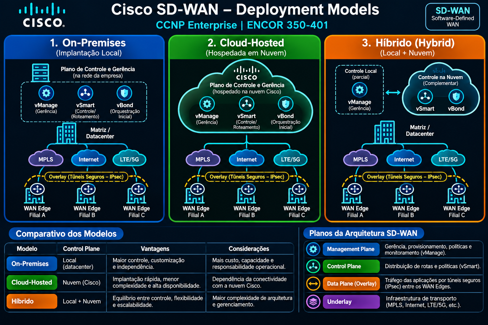
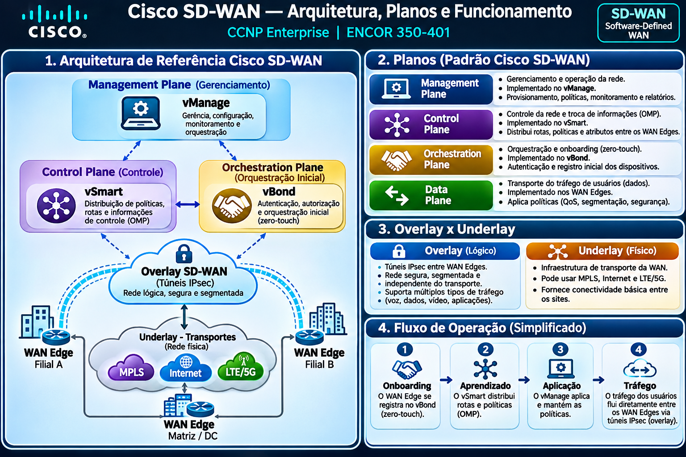

# SD-WAN — CCNP Enterprise ENCOR 350-401

Documentação progressiva dos conceitos de Software-Defined WAN, com foco em compreensão técnica, revisão e laboratórios futuros.

## Conteúdo

| Assunto | Documento | Status |
|---|---|---|
| Modelos de implantação SD-WAN | [deployment-models.md](deployment-models.md) | Teoria inicial |
| Laboratórios SD-WAN | [laboratorios/README.md](laboratorios/README.md) | Planejado |

## Método de estudo

**Estudar → Compreender → Praticar → Documentar → Compartilhar.**

As atividades práticas serão adicionadas somente após execução e validação.

## Diagramas SD-WAN

### 1. Modelos de implantação

### 2. Arquitetura e planos SD-WAN

